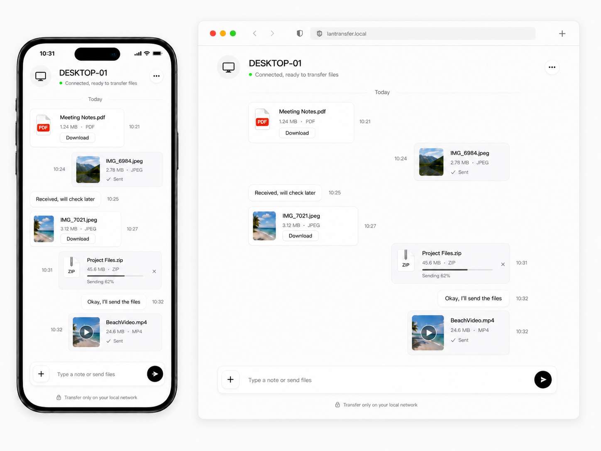
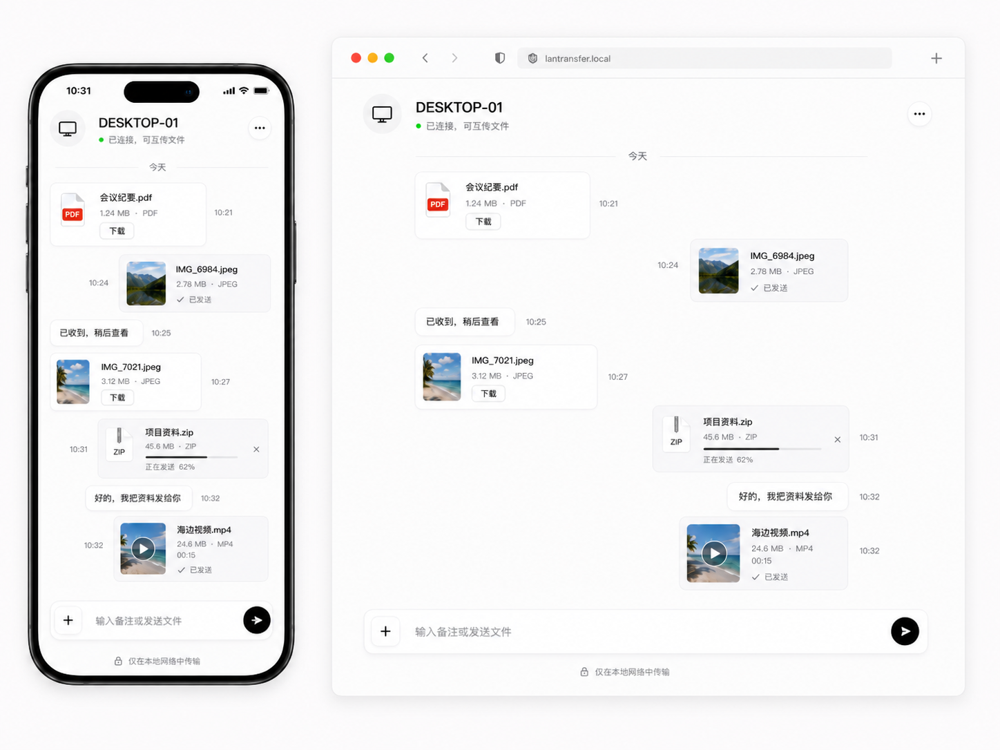

<div align="center">

[中文文档](./README.zh-CN.md) · **English**

# LanTransfer

**A local-first browser workspace for transferring files and plain-text notes across devices on the same LAN.**


[](https://github.com/hongjiapeng/LanTransfer/releases)

</div>

LanTransfer keeps file sharing and quick text handoff in one lightweight local service. Run it on a computer, open the browser UI from a phone, tablet, or another computer on the same trusted network, and transfer directly between devices without an account or cloud service.

## Product tour

| English UI | 简体中文 UI |
|:---:|:---:|
|  |  |
| Browser-based file transfer, downloads, and text notes across devices. | 在桌面电脑和手机之间传输文件、下载文件和发送文本。 |

## What it does

| Area | Capability |
|---|---|
| **File transfer** | Upload files from any modern browser, stream them to local storage, download them from other devices, and copy shareable file links |
| **Text handoff** | Send and persist plain-text notes alongside transferred files |
| **Device connection** | Detect usable LAN addresses, show a QR code, and let you switch between multiple network adapters |
| **Cross-platform host** | Run the receiver on Windows, macOS, or Linux with .NET 10 |
| **Host controls** | Delete text history, move received files to the LanTransfer trash, and reveal file locations in Windows Explorer |
| **Safe storage** | Protect against path traversal, handle duplicate names readably, and use temporary `.uploading` files while receiving |
| **Localization** | Lightweight English, Simplified Chinese, and Traditional Chinese browser UI |
| **Windows integration** | Single-instance behavior, default-browser launch, and an optional tray icon with Open/Exit actions |

## Quick start

1. Download the Windows installer or portable build from [GitHub Releases](https://github.com/hongjiapeng/LanTransfer/releases), or run it from source as shown below.
2. Start LanTransfer on the computer that will receive files.
3. The app listens on `http://0.0.0.0:8765` and opens the local page in your default browser.
4. On another device connected to the same LAN, open `http://<receiver-ip>:8765`, or choose **Connect new device** on the host and scan the QR code.
5. Drag files into the page or enter a plain-text note. Received files can be downloaded from any connected browser.

Run from source:

```bash
dotnet run --project src/LanTransfer.Host
```

Useful addresses:

- Same computer: `http://localhost:8765`
- Another device on the LAN: `http://<receiver-ip>:8765`

> [!IMPORTANT]
> The first version intentionally uses HTTP on the local network, not HTTPS. Use LanTransfer only on a trusted private Wi-Fi/LAN, or configure your own VPN, tunnel, or network boundary for other environments.

## Requirements

| Requirement | Notes |
|---|---|
| Receiver | Windows, macOS, or Linux with the .NET 10 runtime when running from source |
| Sender | Any modern browser on Windows, macOS, Linux, Android, or iOS |
| Network | Devices must be on the same local network unless you provide routing, VPN, or tunneling yourself |
| Windows extras | Windows host actions can reveal a received file in Explorer; the tray integration is Windows-only |

Self-contained release packages include the runtime, so users do not need to install .NET separately.

## Security and privacy

LanTransfer is local-first: files and text are stored on the host computer, and the application does not require an account or send content to a cloud service.

By default, the service is reachable by devices that can access the listening port on the local network. Set `AccessToken` to require an access token for protected API calls. The token can be supplied as `X-LanTransfer-Token` or `?token=...`; generated connection URLs include it when configured.

The optional token helps prevent accidental access, but HTTP does not provide confidentiality against someone who can observe or modify traffic on a hostile network. Do not expose the service directly to the public internet, and avoid sharing token-bearing URLs outside the trusted network.

## Configuration

LanTransfer reads the `LanTransfer` section from `src/LanTransfer.Host/appsettings.json`.

```json
{
  "LanTransfer": {
    "Port": 8765,
    "StorageDirectory": null,
    "MaxFileSizeBytes": 1073741824,
    "MaxMessageLength": 4000,
    "OpenBrowserOnStart": true,
    "EnableWindowsTray": true,
    "AccessToken": null
  }
}
```

| Setting | Default | Description |
|---|---:|---|
| `Port` | `8765` | HTTP listening port. If it is unavailable, LanTransfer selects an available port. |
| `StorageDirectory` | `null` | Received-file and text storage location. The default is under the current user's local application-data directory. |
| `MaxFileSizeBytes` | `1073741824` | Maximum accepted file size, 1 GiB by default. |
| `MaxMessageLength` | `4000` | Maximum length of a plain-text note. |
| `OpenBrowserOnStart` | `true` | Open the host page in the default browser after startup. |
| `EnableWindowsTray` | `true` | Enable the Windows tray icon when running on Windows. |
| `AccessToken` | `null` | Optional token for protected API calls and connection URLs. |

Environment variables can override configuration values using the `LanTransfer__` prefix:

```bash
LanTransfer__Port=9000 dotnet run --project src/LanTransfer.Host
```

On PowerShell:

```powershell
$env:LanTransfer__Port = "9000"
dotnet run --project src/LanTransfer.Host
```

## API overview

| Method | Endpoint | Purpose |
|---|---|---|
| `GET` | `/api/health` | Return service status, name, and host device name |
| `GET` | `/api/capabilities` | Report host-only UI capabilities |
| `GET` | `/api/connect` | Return usable LAN connection URLs |
| `GET` | `/api/connect/qr?url=...` | Return a locally generated SVG QR code |
| `GET` / `POST` | `/api/messages` | List or add plain-text notes |
| `DELETE` | `/api/messages/{id}` | Delete a note from the host computer |
| `POST` | `/api/files/upload` | Upload one multipart file field named `file` |
| `GET` | `/api/files` | List received files |
| `GET` | `/api/files/{fileName}` | Download a received file |
| `POST` | `/api/files/{fileName}/reveal` | Open a file's location in Windows Explorer on the host |
| `DELETE` | `/api/files/{fileName}` | Move a received file to `.lantransfer/trash` on the host |

History deletion and file-location actions are restricted to the host computer. Common stable error codes include `file_too_large`, `invalid_file_name`, `invalid_message`, `unauthorized`, `upload_failed`, `delete_failed`, `host_only_action`, and `network_error`.

## Development

### Build and test

```bash
dotnet restore LanTransfer.sln
dotnet build LanTransfer.sln --configuration Release
dotnet test LanTransfer.sln --configuration Release
```

Run the built executable directly:

```bash
src/LanTransfer.Host/bin/Release/net10.0/lantransfer
```

On Windows:

```powershell
.\src\LanTransfer.Host\bin\Release\net10.0\lantransfer.exe
```

### Portable builds and Windows installer

Create a self-contained Windows x64 publish and build the installer with Inno Setup 6 installed:

```powershell
.\scripts\build-installer.ps1 -Version 0.7.0
```

The installer uses a per-user location, `%LOCALAPPDATA%\Programs\LanTransfer`, requires no administrator privileges, and can optionally create a desktop shortcut or start LanTransfer at sign-in. Received files remain under `%LOCALAPPDATA%\LanTransfer\uploads` and are not removed when the application is uninstalled.

### Release

After committing and pushing the intended changes, run:

```powershell
.\scripts\release.ps1 0.6.2
```

The script runs the test suite, creates an annotated `v0.6.2` tag, and pushes it. GitHub Actions then builds self-contained packages for Windows x64, Linux x64/ARM64, and macOS x64/ARM64, builds the Windows installer, and creates the GitHub Release.

To preview the release checks without creating a tag:

```powershell
.\scripts\release.ps1 0.6.2 -DryRun
```

## Project structure

```text
LanTransfer/
├─ src/
│  ├─ LanTransfer.Core/
│  └─ LanTransfer.Host/
│     └─ wwwroot/
├─ tests/
│  └─ LanTransfer.Tests/
├─ docs/
├─ installer/
├─ screenshots/
├─ scripts/
├─ README.md
├─ README.zh-CN.md
└─ LanTransfer.sln
```

## Roadmap

- Optional expiring pairing-code approval flow
- Rename actions for received files
- Better image and file thumbnails
- Desktop notifications
- Stronger authentication for non-trusted networks

## License

MIT

---

<div align="center">

Built for simple, direct transfers on your local network.

</div>
