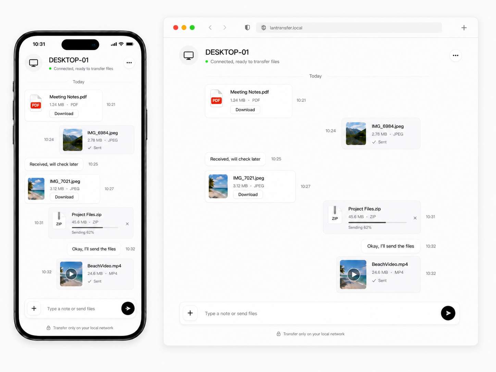
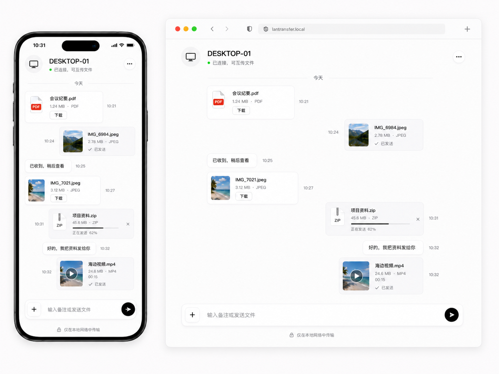

<div align="center">

**中文** · [English](./README.md)

# LanTransfer

**一个基于浏览器的本地优先工作区，用于在同一局域网内的设备之间传输文件和纯文本。**


[](https://github.com/hongjiapeng/LanTransfer/releases)

</div>

LanTransfer 将文件共享和临时文字传递整合在一个轻量的本地服务中。在电脑上运行 LanTransfer 后，手机、平板或同一可信网络中的另一台电脑可以通过浏览器打开页面，在设备之间直接传输内容，无需账号，也不依赖云服务。

## 产品展示

| English 界面 | 简体中文界面 |
|:---:|:---:|
|  |  |
| 在不同设备之间传输文件、下载文件和发送文本。 | 在桌面电脑和手机之间传输文件、下载文件和发送文本。 |

## 功能概览

| 模块 | 能力 |
|---|---|
| **文件传输** | 使用任意现代浏览器上传文件，将文件流式保存到本地，从其他设备下载文件，并复制可分享的文件链接 |
| **文字传递** | 在传输文件的同时发送和保存纯文本备注 |
| **设备连接** | 检测可用的局域网地址，显示二维码，并支持在多个网卡地址之间切换 |
| **跨平台主机** | 使用 .NET 10 在 Windows、macOS 或 Linux 上运行接收端 |
| **主机控制** | 删除文字历史记录，将接收文件移入 LanTransfer 回收区，并在 Windows 资源管理器中定位文件 |
| **安全存储** | 防止路径穿越，清晰处理同名文件，并在接收过程中使用 `.uploading` 临时文件 |
| **界面本地化** | 提供 English、简体中文和繁体中文轻量浏览器界面 |
| **Windows 集成** | 支持单实例、启动后打开默认浏览器，以及通过托盘菜单控制登录时启动 |

## 快速开始

1. 从 [GitHub Releases](https://github.com/hongjiapeng/LanTransfer/releases) 下载 Windows 安装程序或便携版，也可以按下面的说明从源码运行。
2. 在用于接收文件的电脑上启动 LanTransfer。
3. 应用会监听 `http://0.0.0.0:8765`，并在默认浏览器中打开本机页面。
4. 在同一局域网内的另一台设备上打开 `http://<接收端 IP>:8765`，或者在主机页面中选择“连接新设备”并扫描二维码。
5. 将文件拖入页面，或输入纯文本备注。任何已连接的浏览器都可以下载接收文件。

从源码运行：

```bash
dotnet run --project src/LanTransfer.Host
```

常用地址：

- 当前电脑：`http://localhost:8765`
- 局域网内其他设备：`http://<接收端 IP>:8765`

> [!IMPORTANT]
> 第一版在局域网内使用 HTTP，而不是 HTTPS。请仅在可信的私有 Wi-Fi/局域网中使用 LanTransfer；如需跨越其他网络边界，请自行配置 VPN、内网穿透或路由方案。

## 环境要求

| 要求 | 说明 |
|---|---|
| 接收端 | 从源码运行时，需要在 Windows、macOS 或 Linux 上安装 .NET 10 Runtime |
| 发送端 | Windows、macOS、Linux、Android 或 iOS 上的任意现代浏览器 |
| 网络 | 设备需要处于同一局域网；跨网络使用时，需要自行提供路由、VPN 或内网穿透 |
| Windows 特性 | Windows 主机可以在资源管理器中定位接收文件；托盘集成仅适用于 Windows |

自包含发布包已包含运行时，普通用户无需另外安装 .NET。

在 Windows 上，可以右键点击通知区域中的 LanTransfer 图标，勾选或取消勾选“登录 Windows 时启动”。此设置与安装程序中的对应选项共用当前用户的启动快捷方式；登录后应用会按现有配置决定是否打开浏览器。便携版启用后请保持程序路径不变。

## 安全与隐私

LanTransfer 采用本地优先设计：文件和文本保存在主机电脑上，应用不要求账号，也不会将内容发送到云服务。

默认情况下，能够访问监听端口的局域网设备都可以访问服务。配置 `AccessToken` 后，可以为受保护的 API 请求增加访问令牌。令牌可以通过 `X-LanTransfer-Token` 请求头或 `?token=...` query 参数传递；配置令牌后，自动生成的连接地址也会包含令牌。

可选令牌可以减少意外访问，但 HTTP 无法防止恶意网络中的流量被观察或篡改。不要将服务直接暴露到公共互联网，也不要在可信网络之外分享包含令牌的 URL。

## 配置说明

LanTransfer 从 `src/LanTransfer.Host/appsettings.json` 的 `LanTransfer` 节读取配置。

```json
{
  "LanTransfer": {
    "Port": 8765,
    "StorageDirectory": null,
    "MaxFileSizeBytes": 1073741824,
    "MaxMessageLength": 4000,
    "OpenBrowserOnStart": true,
    "EnableWindowsTray": true,
    "AccessToken": null
  }
}
```

| 配置项 | 默认值 | 说明 |
|---|---:|---|
| `Port` | `8765` | HTTP 监听端口。如果该端口不可用，LanTransfer 会选择一个可用端口。 |
| `StorageDirectory` | `null` | 接收文件和文字的存储位置。默认位于当前用户的本地应用数据目录下。 |
| `MaxFileSizeBytes` | `1073741824` | 接受的最大文件大小，默认是 1 GiB。 |
| `MaxMessageLength` | `4000` | 纯文本备注的最大长度。 |
| `OpenBrowserOnStart` | `true` | 启动后是否在默认浏览器中打开主机页面。 |
| `EnableWindowsTray` | `true` | 在 Windows 上运行时是否启用托盘图标。 |
| `AccessToken` | `null` | 用于受保护 API 请求和连接地址的可选令牌。 |

也可以使用带有 `LanTransfer__` 前缀的环境变量覆盖配置：

```bash
LanTransfer__Port=9000 dotnet run --project src/LanTransfer.Host
```

PowerShell 示例：

```powershell
$env:LanTransfer__Port = "9000"
dotnet run --project src/LanTransfer.Host
```

## API 概览

| 方法 | 接口 | 用途 |
|---|---|---|
| `GET` | `/api/health` | 返回服务状态、名称和主机设备名称 |
| `GET` | `/api/capabilities` | 返回仅限主机端使用的界面能力 |
| `GET` | `/api/connect` | 返回可用的局域网连接地址 |
| `GET` | `/api/connect/qr?url=...` | 返回本地生成的 SVG 二维码 |
| `GET` / `POST` | `/api/messages` | 列出或添加纯文本备注 |
| `DELETE` | `/api/messages/{id}` | 在主机电脑上删除文字备注 |
| `POST` | `/api/files/upload` | 上传一个名为 `file` 的 multipart 文件字段 |
| `GET` | `/api/files` | 列出已接收文件 |
| `GET` | `/api/files/{fileName}` | 下载已接收文件 |
| `POST` | `/api/files/{fileName}/reveal` | 在主机的 Windows 资源管理器中打开文件位置 |
| `DELETE` | `/api/files/{fileName}` | 将主机上的接收文件移入 `.lantransfer/trash` 回收区 |

历史记录删除和文件位置操作仅限主机电脑使用。常见稳定错误码包括 `file_too_large`、`invalid_file_name`、`invalid_message`、`unauthorized`、`upload_failed`、`delete_failed`、`host_only_action` 和 `network_error`。

## 开发

### 构建与测试

```bash
dotnet restore LanTransfer.sln
dotnet build LanTransfer.sln --configuration Release
dotnet test LanTransfer.sln --configuration Release
```

直接运行构建后的可执行程序：

```bash
src/LanTransfer.Host/bin/Release/net10.0/lantransfer
```

Windows：

```powershell
.\src\LanTransfer.Host\bin\Release\net10.0\lantransfer.exe
```

### 便携版与 Windows 安装程序

安装 Inno Setup 6 后，可以创建自包含 Windows x64 发布包并构建安装程序：

```powershell
.\scripts\build-installer.ps1 -Version 0.8.0
```

安装程序默认按当前用户安装到 `%LOCALAPPDATA%\Programs\LanTransfer`，不需要管理员权限，并可选择创建桌面快捷方式或在登录 Windows 后启动 LanTransfer。接收文件默认保存在 `%LOCALAPPDATA%\LanTransfer\uploads`，卸载应用不会删除这些用户文件。

### 发布版本

提交并推送预期变更后，运行：

```powershell
.\scripts\release.ps1 0.6.2
```

脚本会运行测试、创建带注释的 `v0.6.2` tag 并推送。随后 GitHub Actions 会构建 Windows x64、Linux x64/ARM64 和 macOS x64/ARM64 自包含发布包，构建 Windows 安装程序，并创建 GitHub Release。

如果只想预览发布检查而不创建 tag：

```powershell
.\scripts\release.ps1 0.6.2 -DryRun
```

## 项目结构

```text
LanTransfer/
├─ src/
│  ├─ LanTransfer.Core/
│  └─ LanTransfer.Host/
│     └─ wwwroot/
├─ tests/
│  └─ LanTransfer.Tests/
├─ docs/
├─ installer/
├─ screenshots/
├─ scripts/
├─ README.md
├─ README.zh-CN.md
└─ LanTransfer.sln
```

## 路线图

- 可选的限时配对码确认流程
- 已接收文件重命名
- 更好的图片和文件缩略图
- 桌面系统通知
- 面向非可信网络的更强认证方案

## 许可证

MIT

---

<div align="center">

为局域网内简单、直接的文件传输而构建。

</div>
